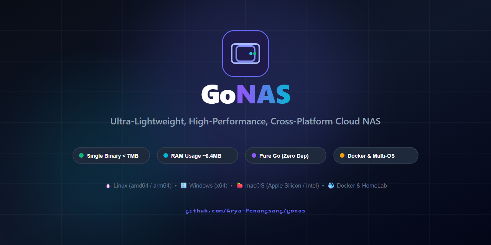

# 🚀 GoNAS — Lightweight, High-Performance, Cross-Platform Cloud NAS

<p align="center">
  
</p>

<p align="center">
  <a href="README.md">English</a> • <b>Bahasa Indonesia</b>
</p>

[](https://golang.org)
[](https://github.com/Arya-Penangsang/gonas)
[]()
[]()
[](LICENSE)

**GoNAS** adalah engine Cloud Web NAS mandiri (*self-hosted*), berkecepatan tinggi, dan ultra-ringan yang dirancang untuk kebutuhan penyimpanan data pribadi, tim, server kantor, homelab, maupun institusi.

Dibangun dengan **Go murni (Golang)** dan mengintegrasikan antarmuka Single-Page Application (SPA) modern berbasis **Tailwind CSS & Lucide Icons** langsung ke dalam satu biner statis (`//go:embed`), GoNAS dapat langsung dijalankan di sistem operasi apa pun tanpa dependensi eksternal (zero-dependency, tanpa Node.js, Python, ataupun database SQL eksternal).

---

## ✨ Fitur Utama (v2.4 Universal Edition)

### 1. 📁 Modern File Manager & Rich Document Viewers
- **Dual View Modes**: Beralih seketika antara **List Table View** (tampilan baris berkontras tinggi dengan metadata lengkap, ukuran folder, dan pemilik) dan **Grid View** (kartu berkas responsif).
- **Embedded Document Viewer**:
  - **PDF Reader**: Canvas viewer interaktif berbasis Mozilla PDF.js dengan zoom in/out, navigasi halaman, dan pratinjau instan.
  - **Microsoft Word (.docx)**: Rendering HTML dokumen langsung di browser tanpa memerlukan Microsoft Office via Mammoth.js.
  - **Excel & Spreadsheet (.xlsx, .xls, .csv)**: Visualisasi tabel spreadsheet interaktif via SheetJS.
  - **Multimedia Player**: Pemutar Video HTML5 & Pemutar Musik/Audio dengan dukungan HTTP 206 Partial Content (range-request seeking).
  - **Teks & Kode Sumber**: Penampil monospace dengan syntax formatting dan tombol salin instan.
- **Hierarchical Sidebar Folder Tree**: Navigasi pohon direktori bertingkat dengan ekspansi panah drop-down dinamis dan ukuran folder kalkulatif.
- **Whole-Window Drag & Drop Upload**: Seret berkas dari komputer mana saja ke browser dengan visual backdrop glow blur dan progress percentage upload yang halus.

### 2. 🚚 Seamless Move & Bulk File Operations
- **Interactive Move Picker**: Modal pemindahan berkas dengan visual tree folder, navigasi breadcrumbs (`Root › Folder › Subfolder`), dan pemilihan folder target dalam satu ketukan.
- **Floating Bulk Action Bar**: Bilah aksi mengambang saat memilih banyak item untuk memindahkan (*bulk move*), merapikan (*auto-arrange*), mengunduh ZIP (*download*), atau menghapus (*delete*).
- **Self-Move & Collision Protection**: Proteksi otomatis agar folder tidak dapat dipindahkan ke dalam dirinya sendiri dan penanganan tabrakan nama berkas otomatis (*auto rename collision*).
- **Touch & Tablet Friendly**: Tombol aksi pada baris berkas dioptimalkan untuk perangkat sentuh/tablet tanpa bergantung pada kursor mouse hover.

### 3. 💽 Flexible Multi-Volume Storage Pooling
GoNAS dirancang untuk menyatukan berbagai media penyimpanan fisik ke dalam satu antarmuka terpadu:
- **Primary Storage Pool**: Direktori atau partisi penyimpanan utama yang ditentukan via argumen `-root` atau env `NAS_ROOT_PATH`.
- **Secondary & Archival Pools**: Mendukung agregasi banyak hard drive, SSD sekunder, partisi disk terpisah, harddisk eksternal USB, maupun direktori mount point jaringan (misalnya `/mnt/storage`, `/mnt/backup`, atau drive `D:\`, `E:\`).
- **Peralihan Volume Transparan**: Pengguna dapat berpindah antar-volume penyimpanan secara instan langsung dari bilah sisi (sidebar) dengan kuota dan status ruang bebas yang terukur secara akurat.

### 4. 🛡️ User Access Control (UAC) & Role Hierarchy
Sistem otentikasi berbasis token HMAC / Session Cookies (`gonas_session`) dengan klasifikasi 4 tingkatan hak akses:

| Peran (Role) | Akses File Manager | Unggah & Hapus | Manajemen Pengguna | Dashboard Telemetri |
| :--- | :---: | :---: | :---: | :---: |
| **Superadmin** | ✅ Penuh | ✅ Ya | ✅ Ya | ✅ Ya |
| **Admin** | ✅ Penuh | ✅ Ya | ❌ Tidak | ✅ Ya |
| **Staf (User)** | ✅ Penuh | ✅ Ya | ❌ Tersembunyi | ❌ Tersembunyi |
| **Tamu (Viewer)** | 👁️ Baca & Unduh | ❌ Diblokir | ❌ Tersembunyi | ❌ Tersembunyi |

### 5. 🪄 Smart Auto-Arrange (Rapikan Otomatis)
Fitur klasifikasi cerdas untuk menyortir berkas tercecer di direktori root secara otomatis ke folder tematik terstandarisasi berdasarkan tipe file (Dokumen, Data Spreadsheet, Media/Foto/Video, Arsip/Backup, dan Aplikasi/Installer).

### 6. ⚡ Kernel Telemetry & In-Memory Audit
- **Sub-milidetik Disk Telemetry**: Membaca kapasitas disk secara native tanpa overhead CPU (Win32 Syscall `GetDiskFreeSpaceExW` di Windows, dan POSIX `statfs` di Linux/macOS/Docker).
- **In-Memory Audit Logger**: Melacak seluruh aktivitas login, unggah, unduh, hapus, dan pemindahan berkas dengan pencatatan IP klien real-time.

---

## 🌐 Matriks Dukungan Platform

GoNAS dapat dikompilasi dan dijalankan secara native di berbagai arsitektur dan sistem operasi:

| Platform / Lingkungan | Cara Menjalankan | Ukuran Biner | Konsumsi RAM |
| :--- | :--- | :---: | :---: |
| **Linux Server** (Ubuntu/Debian/RHEL/CentOS) | Native Binary / Systemd Service | ~6.1 MB | ~6.3 MB |
| **Docker / Docker Compose** | Multi-Stage Container (`alpine:latest`) | < 25 MB | ~6.5 MB |
| **Windows** (10, 11, & Windows Server) | Portable `.exe` / Task Scheduler | ~6.3 MB | ~6.4 MB |
| **macOS** (Apple Silicon M-Series & Intel) | Native Binary / Launchd Daemon | ~6.0 MB | ~6.2 MB |
| **HomeLab & Bare-Metal** (Raspberry Pi, Mini PC) | Linux ARM64 / amd64 | ~6.1 MB | ~6.3 MB |

---

## 🚀 Panduan Deployment & Menjalankan

### Cara 1: Menggunakan Docker Compose (Direkomendasikan untuk Server & HomeLab)
Cara termudah menjalankan GoNAS di server Linux, VPS, atau HomeLab:

```yaml
# docker-compose.yml
version: '3.8'

services:
  gonas:
    build: .
    container_name: gonas-cloud
    restart: unless-stopped
    ports:
      - "8082:8082"
    environment:
      - NAS_PORT=8082
      - NAS_APP_TITLE=GoNAS Cloud Storage
      - NAS_ROOT_PATH=/storage
    volumes:
      - ./storage:/storage        # Sesuaikan dengan path disk lokal Anda
      - ./data:/app/data          # Penyimpanan database akun & config
    healthcheck:
      test: ["CMD", "wget", "-q", "--spider", "http://localhost:8082/api/sys/health"]
      interval: 30s
      timeout: 5s
      retries: 3
```

Jalankan dengan perintah:
```bash
docker compose up -d
```
Akses web di: `http://<IP-SERVER>:8082` atau `http://localhost:8082`.

---

### Cara 2: Menjalankan di Linux Server (Native Binary & Systemd)

#### 1. Jalankan langsung dari Terminal:
```bash
# Berikan hak akses eksekusi
chmod +x gonas

# Jalankan dengan parameter folder penyimpanan Anda
./gonas -port 8082 -root /mnt/storage -user admin -pass admin123
```

#### 2. Pasang sebagai Systemd Service (Otomatis Aktif Saat Boot):
Buat berkas `/etc/systemd/system/gonas.service`:
```ini
[Unit]
Description=GoNAS Cloud Storage Service
After=network.target

[Service]
Type=simple
User=root
WorkingDirectory=/opt/gonas
ExecStart=/opt/gonas/gonas -port 8082 -root /mnt/storage -user admin -pass admin123
Restart=always
RestartSec=5

[Install]
WantedBy=multi-user.target
```

Aktifkan service:
```bash
sudo systemctl daemon-reload
sudo systemctl enable --now gonas
sudo systemctl status gonas
```

---

### Cara 3: Menjalankan di Windows (Biner Portabel & Task Scheduler)

#### 1. Jalankan langsung via PowerShell / CMD:
```powershell
./gonas.exe -port 8082 -root "D:\Storage" -user admin -pass admin123 -title "GoNAS Cloud"
```

#### 2. Pasang sebagai Background Service via Windows Task Scheduler:
```powershell
$action = New-ScheduledTaskAction -Execute 'C:\GoNAS\gonas.exe' -Argument '-port 8082 -root D:\Storage -user admin -pass admin123'
$trigger = New-ScheduledTaskTrigger -AtStartup
Register-ScheduledTask -TaskName 'GoNAS' -Action $action -Trigger $trigger -RunLevel Highest -User 'SYSTEM'
```

---

### Cara 4: Menjalankan di macOS

```bash
chmod +x gonas
./gonas -port 8082 -root ~/NAS_Storage -user admin -pass admin123
```

---

## ⚙️ Referensi Konfigurasi

GoNAS dapat dikonfigurasi melalui **Command-Line Flags** maupun **Environment Variables**:

| Parameter CLI | Environment Variable | Default | Keterangan |
| :--- | :--- | :--- | :--- |
| `-port` | `NAS_PORT` | `8082` | Port HTTP server |
| `-root` | `NAS_ROOT_PATH` | Windows: `N:\` / Linux: `/storage` | Path direktori penyimpanan root |
| `-title` | `NAS_APP_TITLE` | `GoNAS - Cloud Storage` | Judul aplikasi pada browser |
| `-user` | `NAS_DEFAULT_USER` | `admin` | Username default administrator |
| `-pass` | `NAS_DEFAULT_PASS` | `admin123` | Password default administrator |

---

## 🛠️ Kompilasi dari Kode Sumber (Cross-Compilation)

Pastikan Anda memiliki **Go 1.22 atau lebih baru**:

```bash
# Clone repository
git clone https://github.com/Arya-Penangsang/gonas.git
cd gonas

# Kompilasi untuk Windows (x64)
GOOS=windows GOARCH=amd64 go build -ldflags="-s -w" -o gonas.exe .

# Kompilasi untuk Linux (amd64 / x86_64)
GOOS=linux GOARCH=amd64 go build -ldflags="-s -w" -o gonas_linux .

# Kompilasi untuk Linux ARM64 (Raspberry Pi 4/5)
GOOS=linux GOARCH=arm64 go build -ldflags="-s -w" -o gonas_arm64 .

# Kompilasi untuk macOS (Apple Silicon M-Series)
GOOS=darwin GOARCH=arm64 go build -ldflags="-s -w" -o gonas_darwin .
```

---

## 📂 Struktur Repositori

```text
GoNAS/
├── .gitignore              # Pengecualian berkas biner, cache, & data runtime
├── API.md                  # Dokumentasi lengkap REST API v2.4
├── ARCHITECTURE.md         # Rincian desain teknis, I/O streaming, & keamanan
├── Dockerfile              # Multi-stage Docker build ultra-ringan (< 25 MB)
├── docker-compose.yml      # Konfigurasi orkestrasi kontainer production
├── go.mod                  # Definisi modul Go (Zero external dependencies)
├── LICENSE                 # Lisensi Open-Source MIT
├── README.md               # Dokumentasi bahasa Inggris
├── README.id.md            # Dokumentasi bahasa Indonesia
├── disk_posix.go           # Telemetri disk kernel POSIX via statfs (Linux, macOS, Docker)
├── disk_windows.go         # Telemetri disk kernel Win32 via GetDiskFreeSpaceExW (Windows)
├── main.go                 # Engine backend Go utama
└── web/                    # Antarmuka SPA (ter-embed langsung ke dalam biner)
    └── index.html          # Frontend Tailwind CSS, Lucide & Rich Viewers
```

---

## 📄 Lisensi

Proyek ini dilisensikan di bawah **[MIT License](LICENSE)**. Bebas digunakan, dimodifikasi, dan didistribusikan untuk keperluan pribadi, komunitas, homelab, perkantoran, maupun komersial.
