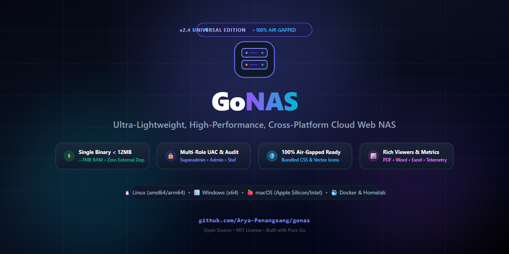

# 🚀 GoNAS — Lightweight, High-Performance, Cross-Platform Cloud NAS

<p align="center">
  
</p>

<p align="center">
  <b>English</b> • <a href="docs/README.id.md">Bahasa Indonesia</a>
</p>

> **GoNAS** is a blazingly fast, single-binary private cloud storage & Web NAS engine (< 10 MB RAM) with embedded PDF/Word viewers, multi-volume pooling, UAC access control, and 100% air-gapped offline readiness. A modern, minimalist alternative to Nextcloud & ownCloud.

[](https://github.com/Arya-Penangsang/gonas/actions/workflows/ci.yml)
[](https://github.com/Arya-Penangsang/gonas/pkgs/container/gonas)
[](https://golang.org)
[](https://github.com/Arya-Penangsang/gonas)
[]()
[]()
[-10B981?style=flat&logo=shield)](docs/SECURITY.md)
[](LICENSE)

**GoNAS** is a self-hosted, ultra-lightweight, and blazingly fast Cloud Web NAS engine designed for personal storage, team collaboration, office servers, homelabs, and digital archiving.

Built with **pure Go (Golang)** and embedding a modern Single-Page Application (SPA) frontend powered by **Tailwind CSS & Lucide Icons** directly into a single static binary (`//go:embed`), GoNAS runs out-of-the-box on any operating system with zero external runtime dependencies (no Node.js, Python, or external SQL database required).

---

## ✨ Key Features (v2.4 Universal Edition)

### 1. 📁 Modern File Manager & Embedded Document Viewers
- **Dual View Modes**: Switch instantly between **List Table View** (high-contrast row layout with metadata, folder sizes, and owners) and **Grid View** (responsive file cards).
- **Embedded Document Viewers**:
  - **PDF Reader**: Interactive canvas viewer powered by Mozilla PDF.js with zoom controls, page navigation, and instant preview.
  - **Microsoft Word (.docx)**: Direct in-browser HTML rendering without Microsoft Office via Mammoth.js.
  - **Excel & Spreadsheets (.xlsx, .xls, .csv)**: Interactive spreadsheet table viewer via SheetJS.
  - **Multimedia Player**: HTML5 Video and Audio players with HTTP 206 Partial Content support for fast range-request seeking.
  - **Source Code & Plain Text**: Clean monospace viewer with syntax styling and one-click copy.
- **Hierarchical Sidebar Folder Tree**: Dynamic multi-level directory tree with collapsible dropdown arrows and real-time calculated folder sizes.
- **Whole-Window Drag & Drop Upload**: Drag files anywhere onto the browser window with a glowing backdrop blur and smooth upload percentage progress.

### 2. 🚚 Seamless Move & Bulk File Operations
- **Interactive Move Picker**: Dedicated file mover modal with visual directory navigation, breadcrumb pathing (`Root › Folder › Subfolder`), and one-tap destination selection.
- **Floating Bulk Action Bar**: Contextual floating action dock when selecting multiple items for bulk move, auto-arrange, zip archive download, or deletion.
- **Self-Move & Collision Protection**: Built-in safeguards preventing folders from being moved into themselves, along with automatic numeric collision resolution (`file (1).ext`).
- **Touch & Tablet Friendly**: Action buttons on table rows remain accessible (`opacity-90`) on mobile and touch devices without requiring mouse hover.

### 3. 💽 Universal Multi-Volume Storage Pooling
GoNAS aggregates diverse physical storage media into a unified dashboard interface:
- **Primary Storage Pool**: The primary root directory configured via the `-root` CLI flag or `NAS_ROOT_PATH` environment variable.
- **Secondary & Archival Pools**: Easily pool multiple hard drives, secondary SSDs, separate partitions, external USB drives, or Linux network mount points (e.g. `/mnt/storage`, `/mnt/backup`, or Windows drive letters `D:\`, `E:\`).
- **Instant Volume Switching**: Switch between storage volumes on the fly directly from the sidebar with real-time free space telemetry.

### 4. 🛡️ User Access Control (UAC) & Role Hierarchy
HMAC token / Session Cookie (`gonas_session`) based authentication with 4 hierarchical access roles:

| Role | File Manager Access | Upload & Delete | User Management | Telemetry Dashboard |
| :--- | :---: | :---: | :---: | :---: |
| **Superadmin** | ✅ Full Access | ✅ Yes | ✅ Yes | ✅ Yes |
| **Admin** | ✅ Full Access | ✅ Yes | ❌ No | ✅ Yes |
| **Staff (User)** | ✅ Full Access | ✅ Yes | ❌ Hidden | ❌ Hidden |
| **Guest (Viewer)** | 👁️ Read & Download | ❌ Blocked | ❌ Hidden | ❌ Hidden |

### 5. 🪄 Smart Auto-Arrange (One-Click Organization)
Intelligent file categorization algorithm that sorts loose root files into standardized thematic folders based on file types (Documents, Spreadsheets, Media/Photos/Videos, Archives/Backups, and Software/Installers).

### 6. ⚡ Native Kernel Telemetry & In-Memory Audit
- **Sub-Millisecond Disk Telemetry**: Measures disk capacity natively with 0% CPU overhead (Win32 Syscall `GetDiskFreeSpaceExW` on Windows, and POSIX `statfs` on Linux, macOS, and Docker).
- **In-Memory Audit Logger**: Tracks login activity, uploads, downloads, deletions, and moves with client IP timestamps (last 150 events).

---

## 🌐 Platform Support Matrix

GoNAS compiles and executes natively across all major architectures and operating systems:

| Platform / Environment | Execution Method | Binary Size | Idle RAM Usage |
| :--- | :--- | :---: | :---: |
| **Linux Server** (Ubuntu/Debian/RHEL/CentOS) | Native Binary / Systemd Service | ~6.1 MB | ~6.3 MB |
| **Docker / Docker Compose** | Multi-Stage Container (`alpine:latest`) | < 25 MB | ~6.5 MB |
| **Windows** (10, 11, & Windows Server) | Portable `.exe` / Task Scheduler | ~6.3 MB | ~6.4 MB |
| **macOS** (Apple Silicon M-Series & Intel) | Native Binary / Launchd Daemon | ~6.0 MB | ~6.2 MB |
| **HomeLab & Bare-Metal** (Raspberry Pi, Mini PC) | Linux ARM64 / amd64 | ~6.1 MB | ~6.3 MB |

---

## 🚀 Quick Start & Deployment Guide

### Method 1: Using Docker Compose (Recommended for Servers & HomeLabs)
The simplest way to deploy GoNAS on Linux servers, VPS instances, or HomeLabs:

```yaml
# docker-compose.yml
version: '3.8'

services:
  gonas:
    build: .
    container_name: gonas-cloud
    restart: unless-stopped
    ports:
      - "8082:8082"
    environment:
      - NAS_PORT=8082
      - NAS_APP_TITLE=GoNAS Cloud Storage
      - NAS_ROOT_PATH=/storage
    volumes:
      - ./storage:/storage        # Map your storage directory
      - ./data:/app/data          # Persistent config and user database
    healthcheck:
      test: ["CMD", "wget", "-q", "--spider", "http://localhost:8082/api/sys/health"]
      interval: 30s
      timeout: 5s
      retries: 3
```

Run with:
```bash
docker compose up -d
```
Access the web interface at: `http://<SERVER-IP>:8082` or `http://localhost:8082`.

---

### Method 2: Linux Production Server (Native Binary & Systemd)

#### 1. Run directly from Terminal:
```bash
# Make binary executable
chmod +x gonas

# Start with custom storage path
./gonas -port 8082 -root /mnt/storage -user admin -pass admin123
```

#### 2. Install as a Systemd Service (Auto-Start on Boot):
Create `/etc/systemd/system/gonas.service`:
```ini
[Unit]
Description=GoNAS Cloud Storage Service
After=network.target

[Service]
Type=simple
User=root
WorkingDirectory=/opt/gonas
ExecStart=/opt/gonas/gonas -port 8082 -root /mnt/storage -user admin -pass admin123
Restart=always
RestartSec=5

[Install]
WantedBy=multi-user.target
```

Enable and start the service:
```bash
sudo systemctl daemon-reload
sudo systemctl enable --now gonas
sudo systemctl status gonas
```

---

### Method 3: Windows Server & Desktop (Portable Binary & Task Scheduler)

#### 1. Run directly via PowerShell / CMD:
```powershell
./gonas.exe -port 8082 -root "D:\Storage" -user admin -pass admin123 -title "GoNAS Cloud"
```

#### 2. Run as a Background Service via Windows Task Scheduler:
```powershell
$action = New-ScheduledTaskAction -Execute 'C:\GoNAS\gonas.exe' -Argument '-port 8082 -root D:\Storage -user admin -pass admin123'
$trigger = New-ScheduledTaskTrigger -AtStartup
Register-ScheduledTask -TaskName 'GoNAS' -Action $action -Trigger $trigger -RunLevel Highest -User 'SYSTEM'
```

---

### Method 4: macOS

```bash
chmod +x gonas
./gonas -port 8082 -root ~/NAS_Storage -user admin -pass admin123
```

---

### Method 5: Raspberry Pi & Single-Board Computers (SBC Homelab)

Thanks to its pure Go zero-dependency static compilation, GoNAS consumes only **~6.4 MB of RAM** and virtually **0% idle CPU**, making it the ultimate private cloud for Raspberry Pi, Orange Pi, Rock Pi, and low-power mini PCs.

#### 1. Quick Cross-Compile for Raspberry Pi (from your PC):
```bash
# Raspberry Pi 3 / 4 / 5 & 64-bit ARM SBCs:
CGO_ENABLED=0 GOOS=linux GOARCH=arm64 go build -ldflags="-s -w" -o gonas-arm64 .

# Raspberry Pi 2 / 3 (32-bit OS) & Pi Zero 2 W:
CGO_ENABLED=0 GOOS=linux GOARCH=arm GOARM=7 go build -ldflags="-s -w" -o gonas-armv7 .

# Raspberry Pi 1 & Pi Zero W (ARMv6):
CGO_ENABLED=0 GOOS=linux GOARCH=arm GOARM=6 go build -ldflags="-s -w" -o gonas-armv6 .
```

#### 2. Run as a 24/7 Silent Background Service (`systemd`):
Create `/etc/systemd/system/gonas.service`:
```ini
[Unit]
Description=GoNAS Lightweight Storage Server
After=network.target

[Service]
Type=simple
User=pi
WorkingDirectory=/home/pi
ExecStart=/home/pi/gonas -port 8082 -root /mnt/external_drive -user admin -pass admin123
Restart=always
RestartSec=5

[Install]
WantedBy=multi-user.target
```

Enable and start:
```bash
sudo systemctl daemon-reload
sudo systemctl enable --now gonas
```

---

## ⚙️ Configuration Reference

GoNAS can be configured via **CLI Flags** or **Environment Variables**:

| CLI Flag | Environment Variable | Default | Description |
| :--- | :--- | :--- | :--- |
| `-port` | `NAS_PORT` | `8082` | HTTP listening port |
| `-root` | `NAS_ROOT_PATH` | Windows: `N:\` / Linux: `/storage` | Root storage directory path |
| `-title` | `NAS_APP_TITLE` | `GoNAS - Cloud Storage` | Application browser title |
| `-user` | `NAS_DEFAULT_USER` | `admin` | Default administrator username |
| `-pass` | `NAS_DEFAULT_PASS` | `admin123` | Default administrator password |

---

## 🛠️ Building from Source (Cross-Compilation)

Requires **Go 1.22 or later**:

```bash
# Clone repository
git clone https://github.com/Arya-Penangsang/gonas.git
cd gonas

# Build for Windows (x64)
GOOS=windows GOARCH=amd64 go build -ldflags="-s -w" -o gonas.exe .

# Build for Linux (amd64 / x86_64)
GOOS=linux GOARCH=amd64 go build -ldflags="-s -w" -o gonas_linux .

# Build for Linux ARM64 (Raspberry Pi 4/5, Oracle Cloud Ampere)
GOOS=linux GOARCH=arm64 go build -ldflags="-s -w" -o gonas_arm64 .

# Build for macOS (Apple Silicon M-Series)
GOOS=darwin GOARCH=arm64 go build -ldflags="-s -w" -o gonas_darwin .
```

---

## 🛡️ Security & Purple Team Hardening (v2.4.1)

GoNAS v2.4.1 has undergone continuous security validation using **Purple Teaming** methodologies (MITRE ATT&CK for Web Applications & OWASP Top 10):

| Mitigation Vector | Technique ID | Implementation Details |
| :--- | :---: | :--- |
| **Strict Path Sandboxing** | `T1083` | Enforced via `filepath.Rel` to eliminate sibling directory traversal bypasses (CWE-22). |
| **Salted Password Hashing** | `T1552.001` | Salted SHA-256 (`sha256$<salt>$<hash>`) with `crypto/subtle.ConstantTimeCompare` & `0600` permissions. |
| **Brute-Force Rate Limiter** | `T1110.001` | Thread-safe in-memory limiter (5 failed logins -> 5-minute lockout with HTTP 429). |
| **Stored XSS Neutralization** | `T1189` | Content-Security-Policy sandbox (`default-src 'none'; sandbox`) injected for `.html`/`.svg` previews. |
| **Global Security Headers** | `CWE-1021` | Enforced `X-Frame-Options: SAMEORIGIN`, `X-Content-Type-Options: nosniff`, and `Referrer-Policy`. |
| **Slowloris DoS Defense** | `T1499` | Server `ReadHeaderTimeout` set to 15 seconds to drop stalled TCP slow-header attacks. |

Read the full technical security audit and patch notes in **[SECURITY.md](docs/SECURITY.md)**.

---

## 📂 Repository Structure

```text
GoNAS/
├── .github/                # GitHub Actions CI/CD workflows & issue templates
│   ├── ISSUE_TEMPLATE/     # Structured bug reports & feature request forms
│   ├── workflows/          # Automated testing, releases & Docker builds
│   ├── PULL_REQUEST_TEMPLATE.md
│   └── SECURITY.md         # GitHub security policy & vulnerability reporting
├── docs/                   # Full Technical & Architectural Documentation
│   ├── API.md              # Comprehensive REST API v2.4 documentation
│   ├── ARCHITECTURE.md     # Technical architecture, 256KB streaming I/O, security specs
│   ├── CONTRIBUTING.md     # Contributor & developer workflow guide
│   ├── README.id.md        # Dokumentasi Bahasa Indonesia
│   ├── SECURITY.md         # Purple Team Security Assessment Report & Patch Notes
│   └── SOCIAL_MEDIA_POSTS.md # Social media publication draft copy
├── web/                    # Static Web Frontend Assets (Embedded into binary)
│   ├── index.html          # Clean & modern reactive SPA web interface
│   ├── style.min.css       # Precompiled minified Tailwind CSS (Offline air-gapped)
│   └── lucide.min.js       # Offline vector icon set
├── .gitattributes          # Linguist language detection & overrides
├── .gitignore              # Git ignore rules (binaries, caches, runtime databases)
├── Dockerfile              # Multi-stage ultra-lightweight Docker build (< 25 MB)
├── docker-compose.yml      # Production container orchestration config
├── go.mod                  # Pure Go module definition (zero dependencies)
├── LICENSE                 # Open-Source MIT License
├── README.md               # English project documentation & deployment guide
├── disk_posix.go           # POSIX kernel disk telemetry via statfs (Linux, macOS, Docker)
├── disk_windows.go         # Win32 Syscall disk telemetry via GetDiskFreeSpaceExW (Windows)
├── main.go                 # Core Go backend engine
├── main_test.go            # Unit test suite for security, auth & path validation
└── tailwind.config.js      # Tailwind CSS build configuration
```

---

## 📄 License

This project is licensed under the **[MIT License](LICENSE)**. Free for personal, commercial, homelab, and enterprise use.
