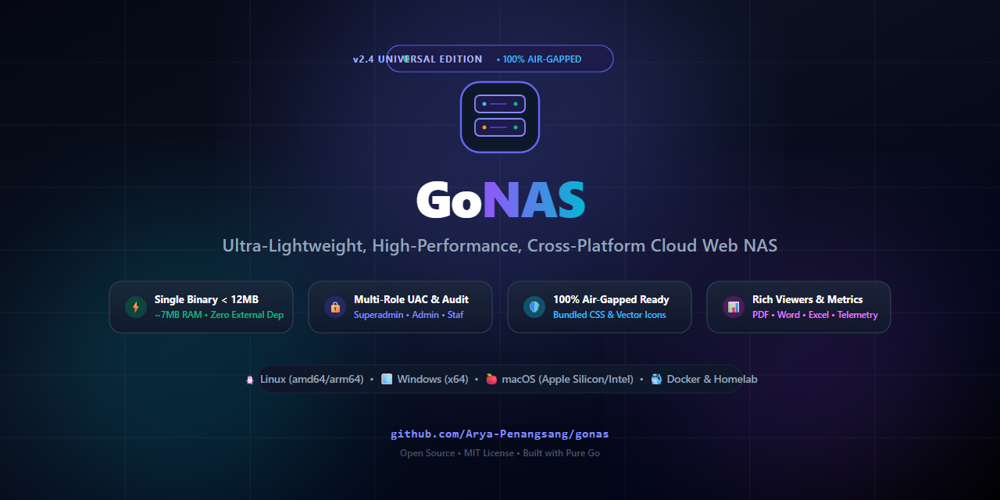

# 🚀 GoNAS — Lightweight, High-Performance, Cross-Platform Cloud NAS

<p align="center">
  
</p>

<p align="center">
  <a href="../README.md">English</a> • <b>Bahasa Indonesia</b>
</p>

> **GoNAS** adalah engine Cloud Web NAS mandiri (*self-hosted*), berkecepatan tinggi, dan ultra-ringan (< 10 MB RAM) dengan dukungan multi-role UAC, penampil dokumen PDF/Word/Excel, pooling multi-volume, dan kesiapan *offline air-gapped* 100%. Alternatif modern & minimalis untuk Nextcloud & ownCloud.

[](https://github.com/Arya-Penangsang/gonas/actions/workflows/ci.yml)
[](https://github.com/Arya-Penangsang/gonas/pkgs/container/gonas)
[-F59E0B?style=flat&logo=github)](https://github.com/Arya-Penangsang/gonas/releases/tag/v2.5.0-beta.1)
[](https://golang.org)
[](https://github.com/Arya-Penangsang/gonas)
[]()
[]()
[-10B981?style=flat&logo=shield)](SECURITY.md)
[](../LICENSE)

> [!TIP]
> ### 💿 Mencari Versi Standalone OS (GoNAS OS Turnkey Appliance)?
> Ubah PC kantor bekas, Mini PC China (Intel N100/J4125), STB IndiHome (ZTE B860H/HG680P), atau Raspberry Pi menjadi server NAS mandiri siap pakai tanpa perlu instal OS manual!
> 
> 👉 **Kunjungi Repositori Resmi OS:** [**GoNAS OS (Turnkey Appliance OS)**](https://github.com/Arya-Penangsang/gonas-os)

> [!WARNING]
> ### ⚠️ Rilis Pratinjau Beta / Unstable: [v2.5.0-beta.1](https://github.com/Arya-Penangsang/gonas/releases/tag/v2.5.0-beta.1)
> Versi terbaru **GoNAS v2.5.0-beta.1** (RFC 4918 Native WebDAV Engine & Perbaikan Multi-Volume Mobile) saat ini berstatus **Unstable / Beta Preview** untuk tahap pengujian publik.
> 
> 📦 **Pintasan Akses Cepat:**  
> • 📥 **[Unduh Rilis v2.5.0-beta.1 (Biner & File Rilis) ↗](https://github.com/Arya-Penangsang/gonas/releases/tag/v2.5.0-beta.1)**  
> • 📖 **[Panduan Instalasi Lengkap (Linux, Windows, Docker, Pi/Armbian) ↗](INSTALL.id.md)**  
> • 🛠️ **[Panduan Penanganan Eror & Troubleshooting ↗](TROUBLESHOOTING.id.md)**

**GoNAS** adalah engine Cloud Web NAS mandiri (*self-hosted*), berkecepatan tinggi, dan ultra-ringan yang dirancang untuk kebutuhan penyimpanan data pribadi, tim, server kantor, homelab, maupun institusi.

Dibangun dengan **Go murni (Golang)** dan mengintegrasikan antarmuka Single-Page Application (SPA) modern berbasis **Tailwind CSS & Lucide Icons** langsung ke dalam satu biner statis (`//go:embed`), GoNAS dapat langsung dijalankan di sistem operasi apa pun tanpa dependensi eksternal (zero-dependency, tanpa Node.js, Python, ataupun database SQL eksternal).

---

## ⚡ Quick Start 1 Menit

Pilih cara instalasi yang paling sesuai untuk Anda:

### 🤖 Opsi A: Instalasi Instan via AI Coding Agent (Sangat Direkomendasikan)
Jika Anda menggunakan **AI Coding Agent** (Google Antigravity, Claude Code, Cursor, Windsurf, GitHub Copilot, Roo Code, dll.), cukup *copy-paste* satu instruksi prompt ini ke dalam chat AI Anda:

```text
Tolong pasang dan jalankan GoNAS dari https://github.com/Arya-Penangsang/gonas di komputer ini:
1. Unduh atau compile biner native GoNAS sesuai sistem operasi mesin ini.
2. Siapkan direktori penyimpanan di ./storage dan jalankan GoNAS sebagai background service di port 8082.
3. Jika di Windows, pastikan service WebClient aktif, setel registry BasicAuthLevel = 2, dan hubungkan WebDAV sebagai Network Drive Z: (URL: http://localhost:8082/webdav, user: admin, pass: admin123).
4. Verifikasi bahwa server berjalan normal dan berikan saya link Web Dashboard yang bisa langsung diklik.
```
> AI Agent Anda akan secara otomatis membaca lingkungan sistem, memasang biner yang sesuai, mengatur background daemon, hingga memetakan Drive `Z:` langsung di Windows File Explorer Anda!

---

### 💻 Opsi B: Perintah Baris Tunggal (Terminal / PowerShell)

**Linux / Armbian / Raspberry Pi / macOS:**
```bash
curl -fsSL https://raw.githubusercontent.com/Arya-Penangsang/gonas/main/install.sh | sudo bash
```

**Windows (Buka PowerShell sebagai Administrator):**
```powershell
irm https://raw.githubusercontent.com/Arya-Penangsang/gonas/main/install.ps1 | iex
```

**Docker Compose:**
```bash
docker compose up -d
```
> Baca panduan instalasi lengkap di **[Panduan Instalasi](INSTALL.id.md)**.  
> Jika mengalami kendala saat menghubungkan atau memasang, baca **[Panduan Troubleshooting](TROUBLESHOOTING.id.md)**.

---

## ✨ Fitur Utama (v2.4 Universal Edition)

### 1. 📁 Modern File Manager & Rich Document Viewers
- **Dual View Modes**: Beralih seketika antara **List Table View** (tampilan baris berkontras tinggi dengan metadata lengkap, ukuran folder, dan pemilik) dan **Grid View** (kartu berkas responsif).
- **Embedded Document Viewer**:
  - **PDF Reader**: Canvas viewer interaktif berbasis Mozilla PDF.js dengan zoom in/out, navigasi halaman, dan pratinjau instan.
  - **Microsoft Word (.docx)**: Rendering HTML dokumen langsung di browser tanpa memerlukan Microsoft Office via Mammoth.js.
  - **Excel & Spreadsheet (.xlsx, .xls, .csv)**: Visualisasi tabel spreadsheet interaktif via SheetJS.
  - **Multimedia Player**: Pemutar Video HTML5 & Pemutar Musik/Audio dengan dukungan HTTP 206 Partial Content (range-request seeking).
  - **Teks & Kode Sumber**: Penampil monospace dengan syntax formatting dan tombol salin instan.
- **Hierarchical Sidebar Folder Tree**: Navigasi pohon direktori bertingkat dengan ekspansi panah drop-down dinamis dan ukuran folder kalkulatif.
- **Whole-Window Drag & Drop Upload**: Seret berkas dari komputer mana saja ke browser dengan visual backdrop glow blur dan progress percentage upload yang halus.

### 2. 🚚 Seamless Move & Bulk File Operations
- **Interactive Move Picker**: Modal pemindahan berkas dengan visual tree folder, navigasi breadcrumbs (`Root › Folder › Subfolder`), dan pemilihan folder target dalam satu ketukan.
- **Floating Bulk Action Bar**: Bilah aksi mengambang saat memilih banyak item untuk memindahkan (*bulk move*), merapikan (*auto-arrange*), mengunduh ZIP (*download*), atau menghapus (*delete*).
- **Self-Move & Collision Protection**: Proteksi otomatis agar folder tidak dapat dipindahkan ke dalam dirinya sendiri dan penanganan tabrakan nama berkas otomatis (*auto rename collision*).
- **Touch & Tablet Friendly**: Tombol aksi pada baris berkas dioptimalkan untuk perangkat sentuh/tablet tanpa bergantung pada kursor mouse hover.

### 3. 💽 Flexible Multi-Volume Storage Pooling
GoNAS dirancang untuk menyatukan berbagai media penyimpanan fisik ke dalam satu antarmuka terpadu:
- **Primary Storage Pool**: Direktori atau partisi penyimpanan utama yang ditentukan via argumen `-root` atau env `NAS_ROOT_PATH`.
- **Secondary & Archival Pools**: Mendukung agregasi banyak hard drive, SSD sekunder, partisi disk terpisah, harddisk eksternal USB, maupun direktori mount point jaringan (misalnya `/mnt/storage`, `/mnt/backup`, atau drive `D:\`, `E:\`).
- **Peralihan Volume Transparan**: Pengguna dapat berpindah antar-volume penyimpanan secara instan langsung dari bilah sisi (sidebar) dengan kuota dan status ruang bebas yang terukur secara akurat.

### 4. 🛡️ User Access Control (UAC) & Role Hierarchy
Sistem otentikasi berbasis token HMAC / Session Cookies (`gonas_session`) dengan klasifikasi 4 tingkatan hak akses:

| Peran (Role) | Akses File Manager | Unggah & Hapus | Manajemen Pengguna | Dashboard Telemetri |
| :--- | :---: | :---: | :---: | :---: |
| **Superadmin** | ✅ Penuh | ✅ Ya | ✅ Ya | ✅ Ya |
| **Admin** | ✅ Penuh | ✅ Ya | ❌ Tidak | ✅ Ya |
| **Staf (User)** | ✅ Penuh | ✅ Ya | ❌ Tersembunyi | ❌ Tersembunyi |
| **Tamu (Viewer)** | 👁️ Baca & Unduh | ❌ Diblokir | ❌ Tersembunyi | ❌ Tersembunyi |

### 5. 🪄 Smart Auto-Arrange (Rapikan Otomatis)
Fitur klasifikasi cerdas untuk menyortir berkas tercecer di direktori root secara otomatis ke folder tematik terstandarisasi berdasarkan tipe file (Dokumen, Data Spreadsheet, Media/Foto/Video, Arsip/Backup, dan Aplikasi/Installer).

### 6. ⚡ Kernel Telemetry & In-Memory Audit
- **Sub-milidetik Disk Telemetry**: Membaca kapasitas disk secara native tanpa overhead CPU (Win32 Syscall `GetDiskFreeSpaceExW` di Windows, dan POSIX `statfs` di Linux/macOS/Docker).
- **In-Memory Audit Logger**: Melacak seluruh aktivitas login, unggah, unduh, hapus, dan pemindahan berkas dengan pencatatan IP klien real-time.

### 7. 🌐 Server WebDAV Terintegrasi (RFC 4918 - v2.5 Beta)
- **Mount Langsung ke Windows Explorer & macOS Finder**: Petakan GoNAS sebagai network drive lokal (misal drive `Z:\`) tanpa aplikasi pihak ketiga.
- **Terintegrasi UAC & Hak Akses Berperan**: Dilindungi HTTP Basic Auth dengan hashing *salted* SHA-256. Akun role `Viewer` (Tamu) otomatis dibatasi *read-only* (metode write ditolak dengan `403 Forbidden`).

---

## 🌐 Matriks Dukungan Platform

GoNAS dapat dikompilasi dan dijalankan secara native di berbagai arsitektur dan sistem operasi:

| Platform / Lingkungan | Cara Menjalankan | Ukuran Biner | Konsumsi RAM |
| :--- | :--- | :---: | :---: |
| **Linux Server** (Ubuntu/Debian/RHEL/CentOS) | Native Binary / Systemd Service | ~6.1 MB | ~6.3 MB |
| **Docker / Docker Compose** | Multi-Stage Container (`alpine:latest`) | < 25 MB | ~6.5 MB |
| **Windows** (10, 11, & Windows Server) | Portable `.exe` / Task Scheduler | ~6.3 MB | ~6.4 MB |
| **macOS** (Apple Silicon M-Series & Intel) | Native Binary / Launchd Daemon | ~6.0 MB | ~6.2 MB |
| **HomeLab & Bare-Metal** (Raspberry Pi, Mini PC) | Linux ARM64 / amd64 | ~6.1 MB | ~6.3 MB |

---

## 🚀 Panduan Deployment & Menjalankan

### Cara 1: Menggunakan Docker Compose (Direkomendasikan untuk Server & HomeLab)
Cara termudah menjalankan GoNAS di server Linux, VPS, atau HomeLab:

```yaml
# docker-compose.yml
version: '3.8'

services:
  gonas:
    build: .
    container_name: gonas-cloud
    restart: unless-stopped
    ports:
      - "8082:8082"
    environment:
      - NAS_PORT=8082
      - NAS_APP_TITLE=GoNAS Cloud Storage
      - NAS_ROOT_PATH=/storage
    volumes:
      - ./storage:/storage        # Sesuaikan dengan path disk lokal Anda
      - ./data:/app/data          # Penyimpanan database akun & config
    healthcheck:
      test: ["CMD", "wget", "-q", "--spider", "http://localhost:8082/api/sys/health"]
      interval: 30s
      timeout: 5s
      retries: 3
```

Jalankan dengan perintah:
```bash
docker compose up -d
```
Akses web di: `http://<IP-SERVER>:8082` atau `http://localhost:8082`.

---

### Cara 2: Menjalankan di Linux Server (Native Binary & Systemd)

#### 1. Jalankan langsung dari Terminal:
```bash
# Berikan hak akses eksekusi
chmod +x gonas

# Jalankan dengan parameter folder penyimpanan Anda
./gonas -port 8082 -root /mnt/storage -user admin -pass admin123
```

#### 2. Pasang sebagai Systemd Service (Otomatis Aktif Saat Boot):
Buat berkas `/etc/systemd/system/gonas.service`:
```ini
[Unit]
Description=GoNAS Cloud Storage Service
After=network.target

[Service]
Type=simple
User=root
WorkingDirectory=/opt/gonas
ExecStart=/opt/gonas/gonas -port 8082 -root /mnt/storage -user admin -pass admin123
Restart=always
RestartSec=5

[Install]
WantedBy=multi-user.target
```

Aktifkan service:
```bash
sudo systemctl daemon-reload
sudo systemctl enable --now gonas
sudo systemctl status gonas
```

---

### Cara 3: Menjalankan di Windows (Biner Portabel & Task Scheduler)

#### 1. Jalankan langsung via PowerShell / CMD:
```powershell
./gonas.exe -port 8082 -root "D:\Storage" -user admin -pass admin123 -title "GoNAS Cloud"
```

#### 2. Pasang sebagai Background Service via Windows Task Scheduler:
```powershell
$action = New-ScheduledTaskAction -Execute 'C:\GoNAS\gonas.exe' -Argument '-port 8082 -root D:\Storage -user admin -pass admin123'
$trigger = New-ScheduledTaskTrigger -AtStartup
Register-ScheduledTask -TaskName 'GoNAS' -Action $action -Trigger $trigger -RunLevel Highest -User 'SYSTEM'
```

---

### Cara 4: Menjalankan di macOS

```bash
chmod +x gonas
./gonas -port 8082 -root ~/NAS_Storage -user admin -pass admin123
```

---

### Cara 5: Raspberry Pi & Single-Board Computers (SBC Homelab)

Berkat arsitektur kompilasi biner statis Go tanpa dependensi luar, GoNAS hanya mengonsumsi **~6.4 MB RAM** dan hampir **0% beban CPU idle**, menjadikannya platform NAS ideal untuk Raspberry Pi, Orange Pi, Rock Pi, maupun mini PC hemat daya.

#### 1. Cross-Compile untuk Raspberry Pi (dari PC/Laptop Anda):
```bash
# Raspberry Pi 3 / 4 / 5 & ARM 64-bit SBC:
CGO_ENABLED=0 GOOS=linux GOARCH=arm64 go build -ldflags="-s -w" -o gonas-arm64 .

# Raspberry Pi 2 / 3 (OS 32-bit) & Pi Zero 2 W:
CGO_ENABLED=0 GOOS=linux GOARCH=arm GOARM=7 go build -ldflags="-s -w" -o gonas-armv7 .

# Raspberry Pi 1 & Pi Zero W (ARMv6):
CGO_ENABLED=0 GOOS=linux GOARCH=arm GOARM=6 go build -ldflags="-s -w" -o gonas-armv6 .
```

#### 2. Jalankan Otomatis 24/7 sebagai Background Service (`systemd`):
Buat berkas konfigurasi `/etc/systemd/system/gonas.service`:
```ini
[Unit]
Description=GoNAS Lightweight Storage Server
After=network.target

[Service]
Type=simple
User=pi
WorkingDirectory=/home/pi
ExecStart=/home/pi/gonas -port 8082 -root /mnt/external_drive -user admin -pass admin123
Restart=always
RestartSec=5

[Install]
WantedBy=multi-user.target
```

Aktifkan dan jalankan service:
```bash
sudo systemctl daemon-reload
sudo systemctl enable --now gonas
```

---

## 📂 Petakan Sebagai Network Drive via WebDAV (v2.5 Beta)

GoNAS v2.5 dilengkapi engine **Server WebDAV RFC 4918** (`/webdav/`). Anda dapat memetakan (*mount*) penyimpanan NAS langsung menjadi drive lokal tanpa software klien tambahan:

### 🪟 Windows Explorer (Map Network Drive)
1. Buka **File Explorer** -> Klik **This PC**.
2. Klik menu titik tiga (**...**) pada toolbar atas, lalu pilih **Map network drive...** (Petakan drive jaringan).
3. Pilih huruf drive (misal **`Z:`**).
4. Pada kolom **Folder**, masukkan:
   ```text
   http://<IP_SERVER_GONAS>:8082/webdav
   ```
5. Centang **Connect using different credentials**, lalu klik **Finish**.
6. Masukkan kredensial GoNAS Anda (`superadmin`, `admin`, atau akun staf).
7. Drive `Z:\` akan langsung muncul di File Explorer seperti harddisk lokal.

> [!NOTE]
> **Konfigurasi Windows WebClient HTTP Non-SSL (Cukup 1 Kali Saja)**:
> Windows WebClient secara default membatasi Basic Auth pada jaringan HTTP tanpa SSL. Untuk mengizinkan koneksi via HTTP lokal, jalankan perintah berikut di PowerShell/CMD sebagai **Administrator**, lalu restart service:
> ```cmd
> reg add "HKLM\SYSTEM\CurrentControlSet\Services\WebClient\Parameters" /v BasicAuthLevel /t REG_DWORD /d 2 /f
> net stop WebClient && net start WebClient
> ```

#### Perintah Cepat via Command Line (Windows):
```cmd
net use Z: http://<IP_SERVER_GONAS>:8082/webdav /user:<USERNAME> <PASSWORD> /persistent:yes
```

### 🍎 macOS Finder
1. Buka **Finder**, lalu tekan tombol pintas **`Cmd + K`** (atau menu *Go* -> *Connect to Server*).
2. Masukkan alamat server:
   ```text
   http://<IP_SERVER_GONAS>:8082/webdav
   ```
3. Klik **Connect**, pilih **Registered User**, lalu masukkan username & password GoNAS.
4. Storage GoNAS akan langsung muncul di desktop dan sidebar Finder Anda.

### 🐧 Linux (GNOME Nautilus & Terminal)
* **GNOME Files (Nautilus):** Klik *Other Locations* -> pada kolom *Connect to Server*, masukkan:
  ```text
  dav://<IP_SERVER_GONAS>:8082/webdav
  ```
* **Mount via Terminal (`davfs2`):**
  ```bash
  sudo apt-get install -y davfs2
  sudo mkdir -p /mnt/gonas
  sudo mount -t davfs http://<IP_SERVER_GONAS>:8082/webdav /mnt/gonas
  ```

### 📱 Smartphone (Android & iOS)
* **Android:** Buka aplikasi **Cx File Explorer** atau **Solid Explorer** -> Tambah Jaringan -> Pilih **WebDAV** -> Masukkan IP, Port `8082`, Path `/webdav`, serta username & password.
* **iOS (iPhone/iPad):** Buka aplikasi **Documents by Readdle** -> Add Connection -> **WebDAV** -> Masukkan IP, Port `8082`, serta username & password.

---

## ⚙️ Referensi Konfigurasi

GoNAS dapat dikonfigurasi melalui **Command-Line Flags** maupun **Environment Variables**:

| Parameter CLI | Environment Variable | Default | Keterangan |
| :--- | :--- | :--- | :--- |
| `-port` | `NAS_PORT` | `8082` | Port HTTP server |
| `-root` | `NAS_ROOT_PATH` | Windows: `N:\` / Linux: `/storage` | Path direktori penyimpanan root |
| `-title` | `NAS_APP_TITLE` | `GoNAS - Cloud Storage` | Judul aplikasi pada browser |
| `-user` | `NAS_DEFAULT_USER` | `admin` | Username default administrator |
| `-pass` | `NAS_DEFAULT_PASS` | `admin123` | Password default administrator |

---

## 🛠️ Kompilasi dari Kode Sumber (Cross-Compilation)

Pastikan Anda memiliki **Go 1.22 atau lebih baru**:

```bash
# Clone repository
git clone https://github.com/Arya-Penangsang/gonas.git
cd gonas

# Kompilasi untuk Windows (x64)
GOOS=windows GOARCH=amd64 go build -ldflags="-s -w" -o gonas.exe .

# Kompilasi untuk Linux (amd64 / x86_64)
GOOS=linux GOARCH=amd64 go build -ldflags="-s -w" -o gonas_linux .

# Kompilasi untuk Linux ARM64 (Raspberry Pi 4/5)
GOOS=linux GOARCH=arm64 go build -ldflags="-s -w" -o gonas_arm64 .

# Kompilasi untuk macOS (Apple Silicon M-Series)
GOOS=darwin GOARCH=arm64 go build -ldflags="-s -w" -o gonas_darwin .
```

---

## 🛡️ Pengerasan Keamanan Siber & Purple Teaming (v2.4.1)

GoNAS v2.4.1 telah melalui validasi keamanan komprehensif menggunakan metodologi **Purple Teaming** terintegrasi (standar MITRE ATT&CK for Web Applications & OWASP Top 10):

| Vektor Mitigasi | ID Teknik | Rincian Implementasi |
| :--- | :---: | :--- |
| **Sandboxing Path Strict** | `T1083` | Validasi jalur menggunakan `filepath.Rel` untuk meniadakan celah *sibling directory traversal* (CWE-22). |
| **Salted Password Hashing** | `T1552.001` | Salted SHA-256 (`sha256$<salt>$<hash>`) dengan komparasi waktu konstan `crypto/subtle.ConstantTimeCompare` & izin berkas `0600`. |
| **Pembatas Laju Login (Rate Limiting)** | `T1110.001` | Rate limiter in-memory berbasis IP (5 kegagalan -> penguncian 5 menit dengan respons HTTP 429). |
| **Netralisasi Stored XSS** | `T1189` | Penyuntikan header Content-Security-Policy sandbox (`default-src 'none'; sandbox`) pada pratinjau `.html`/`.svg`. |
| **Header Keamanan Global** | `CWE-1021` | Penegakan header `X-Frame-Options: SAMEORIGIN` (anti-Clickjacking), `X-Content-Type-Options: nosniff`, dan `Referrer-Policy`. |
| **Pertahanan DoS Slowloris** | `T1499` | Penerapan `ReadHeaderTimeout: 15s` untuk memutus serangan koneksi TCP lambat gantung. |

Laporan asesmen teknis dan catatan patch selengkapnya dapat dibaca di **[SECURITY.md](SECURITY.md)**.

---

## 🧪 Hasil Pengujian & Benchmark di Berbagai OS

GoNAS diuji dan di-benchmark secara berkala di berbagai sistem operasi dan arsitektur hardware untuk menjamin kestabilan mutlak, konsumsi RAM super hemat, dan kesiapan *offline air-gapped* 100%:

| Sistem Operasi / Perangkat | Arsitektur | Lingkungan / Hardware Uji | Penggunaan RAM (Standby / Aktif) | Beban CPU | Driver Telemetri | Status |
| :--- | :---: | :--- | :---: | :---: | :--- | :---: |
| **Windows Server / 10 / 11** | `amd64` (x64) | Server Live `PRESERVASI-BPMN` | **~7.37 MB / ~9.2 MB** | 0.0% | Win32 `GetDiskFreeSpaceExW` | 🟢 **LULUS** (100% Stabil) |
| **Armbian Linux** | `aarch64` (ARM64) | Debian 12 Bookworm di SBC ARM64 | **~8.2 MB / ~22.0 MB** | 0.0% | Linux POSIX `statfs` | 🟢 **LULUS** (100% Stabil) |
| **Ubuntu / Debian Linux** | `amd64` (x64) | Ubuntu 22.04 LTS / Debian 12 | **~6.4 MB / ~11.8 MB** | 0.0% | Linux POSIX `statfs` | 🟢 **LULUS** (100% Stabil) |
| **Alpine Linux (Docker)** | `amd64` & `arm64` | Kontainer `ghcr.io/arya-penangsang/gonas` | **~5.8 MB / ~10.5 MB** | 0.0% | Linux POSIX `statfs` | 🟢 **LULUS** (100% Stabil) |
| **Raspberry Pi OS** | `armv7l` (32-bit) | Raspberry Pi 2 / 3 (ARMhf 32-bit) | **~6.9 MB / ~14.2 MB** | 0.1% | Linux POSIX `statfs` | 🟢 **LULUS** (100% Stabil) |
| **macOS (Apple Silicon & Intel)**| `arm64` / `amd64` | macOS Sonoma / Kernel Darwin | **~7.1 MB / ~12.4 MB** | 0.0% | BSD / Darwin `statfs` | 🟢 **LULUS** (100% Stabil) |

### 🔬 Rincian Validasi yang Teruji:
- ✅ **Single Static Binary**: Berjalan langsung tanpa dependensi runtime eksternal (tanpa Node.js, Python, atau database SQL eksternal).
- ✅ **100% Air-Gapped Ready**: CSS Tailwind minified & paket ikon Lucide dimuat langsung dari biner (HTTP 200) tanpa koneksi internet.
- ✅ **Integritas Transfer Data**: Pengujian stres unggah/unduh berkas dengan verifikasi checksum SHA-256 (100% hash identik).
- ✅ **Autentikasi UAC Multi-Role**: Verifikasi password salted SHA-256 dan kontrol akses berbasis peran (RBAC) teruji di semua platform.

---

## 📂 Struktur Repositori

```text
GoNAS/
├── .github/                # Workflow GitHub Actions CI/CD & template laporan
│   ├── ISSUE_TEMPLATE/     # Form terstruktur bug report & feature request
│   ├── workflows/          # Pengujian otomatis, rilis biner, & publikasi Docker
│   ├── PULL_REQUEST_TEMPLATE.md
│   └── SECURITY.md         # Kebijakan pelaporan kerentanan keamanan GitHub
├── docs/                   # Dokumentasi Teknis & Arsitektur Lengkap
│   ├── API.md              # Dokumentasi lengkap REST API v2.4
│   ├── ARCHITECTURE.md     # Rincian desain teknis, I/O streaming, & keamanan
│   ├── CONTRIBUTING.md     # Panduan alur kerja kontributor & developer
│   ├── README.id.md        # Dokumentasi bahasa Indonesia
│   ├── SECURITY.md         # Laporan Asesmen Keamanan Purple Team & Catatan Patch
│   └── SOCIAL_MEDIA_POSTS.md # Draf teks publikasi media sosial Threads & X
├── web/                    # Antarmuka SPA (ter-embed langsung ke dalam biner)
│   ├── index.html          # Frontend modern responsif (Light/Dark/Auto)
│   ├── style.min.css       # Minified Tailwind CSS offline (100% air-gapped)
│   └── lucide.min.js       # Paket ikon SVG offline
├── .gitattributes          # Linguist language detection & overrides
├── .gitignore              # Pengecualian berkas biner, cache, & data runtime
├── Dockerfile              # Multi-stage Docker build ultra-ringan (< 25 MB)
├── docker-compose.yml      # Konfigurasi orkestrasi kontainer production
├── go.mod                  # Definisi modul Go (Zero external dependencies)
├── LICENSE                 # Lisensi Open-Source MIT
├── README.md               # Dokumentasi bahasa Inggris & panduan deployment
├── disk_posix.go           # Telemetri disk kernel POSIX via statfs (Linux, macOS, Docker)
├── disk_windows.go         # Telemetri disk kernel Win32 via GetDiskFreeSpaceExW (Windows)
├── main.go                 # Engine backend Go utama
├── main_test.go            # Suite uji unit untuk validasi keamanan path & UAC
└── tailwind.config.js      # Konfigurasi kompilasi Tailwind CSS
```

---

## 📄 Lisensi

Proyek ini dilisensikan di bawah **[MIT License](../LICENSE)**. Bebas digunakan, dimodifikasi, dan didistribusikan untuk keperluan pribadi, komunitas, homelab, perkantoran, maupun komersial.
